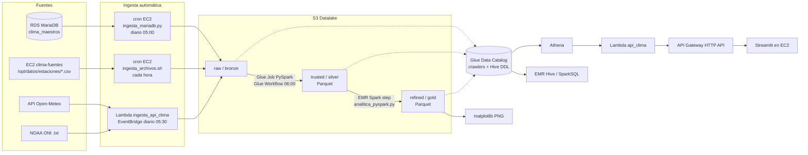

# Arquitectura y decisiones de diseño



## Zonas del datalake

```
s3://clima-colombia-datalake-<cuenta>/
├── raw/                                   ← BRONZE: copia fiel de la fuente
│   ├── mariadb/departamento/fecha_ingesta=AAAA-MM-DD/departamento.csv
│   ├── mariadb/ciudad/fecha_ingesta=AAAA-MM-DD/ciudad.csv
│   ├── archivos_ec2/estaciones/anio=2022/EST_05001_2022.csv
│   ├── api_openmeteo/fecha_ingesta=AAAA-MM-DD/clima_HHMMSS.jsonl
│   └── api_noaa/oni/fecha_ingesta=AAAA-MM-DD/oni.ascii.txt
├── trusted/                               ← SILVER: limpio, tipado, unificado
│   ├── dim_ciudad/
│   ├── clima_diario/anio=AAAA/mes=M/
│   └── oni_mensual/
├── refined/                               ← GOLD: respuestas y agregados
│   ├── clima_mensual/
│   └── p1_ciudad_mas_caliente_abr2025/ ... p8_poblacion_expuesta_calor/
├── scripts/                               ← código para Glue y EMR
└── athena-results/
```

## Decisiones (y por qué)

1. **Raw guarda exactamente lo que llegó.** Ni se limpia ni se cambia formato. Si la
   limpieza tiene un error, se puede reprocesar desde raw. Cada carga queda en una
   partición `fecha_ingesta=` para tener historia y trazabilidad.
2. **La ingesta corre donde está la fuente.** El RDS está en una VPC privada; el
   EC2 está en la misma VPC y tiene `LabInstanceProfile`, así que extrae y sube a S3
   sin llaves. La API pública no necesita VPC, entonces va en **Lambda + EventBridge**
   (serverless, sin servidor encendido). Glue JDBC hacia RDS también funciona, pero
   en Learner Lab exige configurar conexiones VPC/endpoint S3 y suele fallar;
   el script en EC2 es más simple de reproducir.
3. **Ingesta incremental idempotente de la API.** Cada ejecución pide los últimos 10
   días (ERA5 tiene ~5 días de retraso), con lo que se cubren días tardíos y
   correcciones. Los duplicados se resuelven en trusted quedándose con la
   `fecha_ingesta` más reciente por (`id_ciudad`, `fecha`).
4. **Trusted en Parquet particionado por año/mes.** Columnar y comprimido: Athena
   cobra por bytes leídos y las consultas por periodo leen solo sus particiones.
5. **Un mismo esquema para dos orígenes.** Los CSV legados (`;`, coma decimal,
   `dd/mm/aaaa`, `-999`) y el JSON de la API se normalizan al mismo esquema
   `clima_diario` con columna `fuente`. Esa es la "preparación de datos" del punto 4.
6. **Reglas de calidad explícitas.** Rango válido de temperatura −10..50 °C,
   precipitación 0..500 mm, `temp_max ≥ temp_min`; los valores fuera de rango pasan
   a nulo (no se borra la fila) y se cuenta cuántos hubo en el log del job.
7. **Un solo catálogo.** Glue Data Catalog es el metastore de Athena, de Glue y de
   EMR (Hive y Spark se configuran para usarlo). Una tabla creada por crawler se ve
   en Hive y una creada con DDL de Hive se ve en Athena.
8. **Streamlit consume una API, no expone Streamlit "detrás" de API Gateway.**
   Streamlit usa WebSockets (`/_stcore/stream`) y el *HTTP API* de API Gateway no
   reenvía WebSockets, así que el proxy directo se queda en "Please wait…". El
   patrón correcto es: **API Gateway → Lambda → Athena** devuelve JSON, y la app
   Streamlit (en EC2) consume esa API. Si el profesor exige que la URL de la app
   también pase por API Gateway, en el README del punto 8 está la alternativa
   (integración HTTP proxy) con su limitación.
9. **Todo con LabRole.** Learner Lab no permite crear roles IAM; Lambda, Glue y
   API Gateway usan `LabRole`, EC2 usa `LabInstanceProfile` y EMR los roles
   `EMR_DefaultRole` / `EMR_EC2_DefaultRole`.
10. **Costo y sesiones de 4 horas.** El EMR se crea con auto-terminación por
    inactividad y se apaga al terminar; el RDS es `db.t3.micro`. Las credenciales
    del laboratorio cambian en cada sesión, por eso nada guarda llaves: todo usa
    roles.
